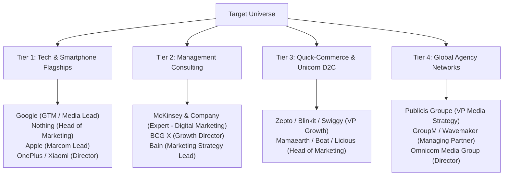

# Targeted Job Search Strategy & Executive Outreach Engine
**Candidate:** Utkarsh Seth  
**Target Level:** VP / Head of Marketing | Director of Growth | Strategy Practice Lead  
**Target Compensation Band:** ₹60 LPA – ₹1.2 Cr+ ($150,000 – $250,000+)  

---

## 1. Target Company Tiers & Specific Roles

---

### Tier 1: Consumer Tech & Smartphone Flagships
*Why you win here:* Unmatched smartphone pedigree (Samsung Galaxy S26/S25, Vivo NEX/V9, Micromax IN), flagship GTM mastery, and proven ability to lead massive agency and cross-functional teams.
* **Target Companies:**
  * **Nothing India:** Head of Marketing / Marketing Director (Carl Pei's brand values culture, design, and viral community marketing — matches your @7enstrings creative sensibility and Guinness record scale).
  * **Google India:** Product Marketing Manager (PMM) / Media Strategy Lead (Hardware & Devices - Pixel / Android ecosystem). Your 6x Digital Guru certification and Samsung flagship GTM are perfect fits.
  * **Apple India:** Marketing Communications (Marcom) Lead - iPhone / iPad.
  * **OnePlus / Realme / Xiaomi:** Director of Brand & Performance Marketing.

---

### Tier 2: Management Consulting & Advisory (The McKinsey Track)
*Why you win here:* Rare dual capability (Brand Custodian P&L owner + Agency Account Director) combined with pioneer status in Generative AI Engine Optimization (AEO/GEO) and MMM media incrementality.
* **Target Practices:**
  * **McKinsey & Company:** Expert – Digital Marketing & Growth Practice.
  * **BCG X / Boston Consulting Group:** Senior Director / Expert – Marketing & Media Optimization.
  * **Bain & Company:** Marketing Excellence Practice Lead.

---

### Tier 3: High-Growth Quick-Commerce & D2C Unicorns
*Why you win here:* Hands-on ownership of conversion funnels, e-commerce scale (Amazon & Flipkart), and rapid execution of pop culture viral campaigns.
* **Target Companies:**
  * **Zepto / Blinkit / Swiggy Instamart:** VP of Growth / Head of Brand & Digital.
  * **boAt Lifestyle / Noise / Boult Audio:** Chief Marketing Officer / VP Marketing.
  * **Mamaearth (Honasa Consumer) / Nykaa:** Head of Performance & Paid Media.

---

### Tier 4: Global Agency Networks
*Why you win here:* 13+ years agency leadership pedigree (Cheil India / Samsung), proven ability to direct ₹100 Cr+ client relationships, and team leadership of 25+.
* **Target Companies:**
  * **Publicis Media / Starcom / Zenith:** Senior Vice President (SVP) / Managing Partner.
  * **GroupM (Mindshare / Wavemaker):** Executive Director – Digital Strategy.
  * **Dentsu / Omnicom Media Group (OMG):** Practice Head – Next-Gen Media & AI.

---

## 2. Top Executive Search Firms in India (Direct Outreach Directory)

At the VP/Director level (₹60L–₹1.2Cr+), over 70% of roles are filled through confidential retained executive search firms. Directly target the Managing Directors and Practice Heads covering **Consumer, Tech, and Digital/Marketing** at:

1. **Korn Ferry India** (Gurgaon / Mumbai)
   * Focus: Enterprise CMOs, Consumer Tech & Consulting Practice Leads.
2. **Spencer Stuart India** (New Delhi / Mumbai)
   * Focus: C-suite and Board appointments for multinational consumer brands.
3. **Michael Page India** (Gurgaon / Bengaluru)
   * Focus: Digital Marketing Heads, VP Growth, Performance Leads (Contact: Gurgaon Executive Team).
4. **Native Agency** (Gurgaon / Bengaluru / Mumbai)
   * Focus: India’s premier executive search firm for unicorn startups, D2C, and consumer tech VP roles.
5. **Heidrick & Struggles** (New Delhi / Mumbai)
   * Focus: Global tech and consulting leadership tracks.
6. **Vito India** (Mumbai / Bengaluru / Delhi-NCR)
   * Focus: Specialized executive headhunters for Consumer, Digital, and Media practices.

---

## 3. High-Converting Executive Outreach DM Templates

### Template 1: Direct to Founder / CEO / CMO (For Tech & D2C Brands)
**Subject:** Scaling Brand & AI Discovery for [Company Name] — Utkarsh Seth (Ex-Cheil/Samsung, Vivo)

> Hi [First Name],
> 
> Loved [Company Name]’s recent momentum around [recent campaign/product launch].
> 
> Having commanded marketing strategy from both sides of the table—as an in-house brand custodian at **Vivo & Micromax** and as agency Account Director running **Samsung India’s full digital mandate at Cheil**—I’ve spent the last 13+ years scaling brands through culture and quantitative media rigour:
> 
> • Managed **₹100 Cr+ annual media deployments** (Vivo IPL, FIFA World Cup, Samsung Galaxy S25/S26).  
> • Pioneered India’s first enterprise **Gen AI Engine Optimization (AEO/GEO) & Reddit Seeding** framework to capture dominant Share of Model in ChatGPT and Perplexity.  
> • Authored **two Guinness World Records** (#WithGalaxy with Kabir Khan) and won Bronze at **Clio Sports** for our Paris Olympics 2024 film (#IndiaCheersNeeraj).  
> 
> I’ve compiled an interactive breakdown of these case studies and my full portfolio here: **https://utkarshseth.vercel.app**
> 
> If you are looking for an executive marketing leader to command full-funnel brand scale and next-gen AI discovery for [Company Name], I’d love to connect for a 15-minute introductory conversation.
> 
> Best regards,  
> Utkarsh Seth  
> +91 9711133607 | anshu.seth007@gmail.com  
> [linkedin.com/in/utkarshseth1](https://linkedin.com/in/utkarshseth1)

---

### Template 2: To Executive Search Partners & Headhunters
**Subject:** Executive Profile: Utkarsh Seth | VP & Head of Marketing (Ex-Samsung/Cheil, Vivo | ₹100Cr+ Scale | AI Pioneer)

> Hi [Partner Name],
> 
> I hope this note finds you well.
> 
> I am reaching out to introduce my profile for confidential executive searches across **VP / Head of Marketing, Growth Director, or Strategy Practice Lead** mandates in India or APAC.
> 
> A brief snapshot of my credentials:
> • **13+ Years Experience:** Dual background as Brand Custodian (Vivo, Micromax) and Agency Director (Cheil India running Samsung).
> • **Enterprise Scale:** Managed ₹100 Cr+ annual media budgets across Vivo IPL and Samsung Galaxy launches; led 15+ member teams.
> • **AI-First Innovation:** Pioneer in AEO/GEO (Generative Engine Optimization) and Reddit seeding for LLM discovery (ChatGPT, Gemini, Perplexity).
> • **Accolades & Education:** 2x Guinness World Records, Clio Sports Award, 6x Google Ads Digital Guru certified, IIT Delhi DMS (CEP).
> 
> My interactive case studies and executive portfolio can be viewed here: **https://utkarshseth.vercel.app**  
> Attached is my executive CV for your confidential candidate database.
> 
> Would you have 10 minutes this week for a brief introductory call to discuss active mandates?
> 
> Warm regards,  
> Utkarsh Seth  
> +91 9711133607 | anshu.seth007@gmail.com

---

## 4. Executive Interview Battlecards

When interviewing with Founders, CEOs, or McKinsey/BCG Senior Partners:

### Card 1: "How do you split budget between Brand Awareness and Performance?"
* **Your Answer:** *"I avoid the false dichotomy of 'Brand vs Performance'. Every performance ad communicates brand equity, and every brand film must drive quantifiable downstream intent. I use a 60/40 or 70/30 Brand-to-Demand allocation calibrated by econometric Marketing Mix Modeling (MMM). At Vivo and Samsung, we proved that top-of-funnel cultural IPs (like IPL or the Olympics) drop blended customer acquisition cost (CAC) across lower-funnel Google Search and Amazon ads by over 25% due to surge in unbranded organic intent."*

### Card 2: "What is your perspective on AI search disruption (AEO vs traditional SEO)?"
* **Your Answer:** *"Traditional SEO optimized for blue hyperlinks; Generative AI Engine Optimization (AEO) optimizes for synthesized conversational answers. In our Samsung framework, we identified that LLMs (ChatGPT, Perplexity, Gemini) heavily rely on trusted high-authority crawl partnerships—specifically Reddit and niche technical subreddits. By structuring machine-readable JSON schemas and seeding authentic, expert technical discourse in r/Android and r/Samsung, we established Samsung Galaxy as the default answer for high-intent purchase queries, creating a new, unassailable Share of Model (SoM) before competitors even realized the search landscape had shifted."*
